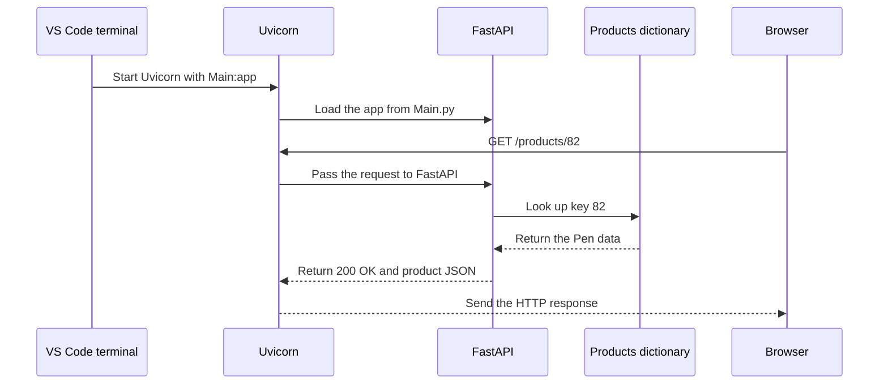
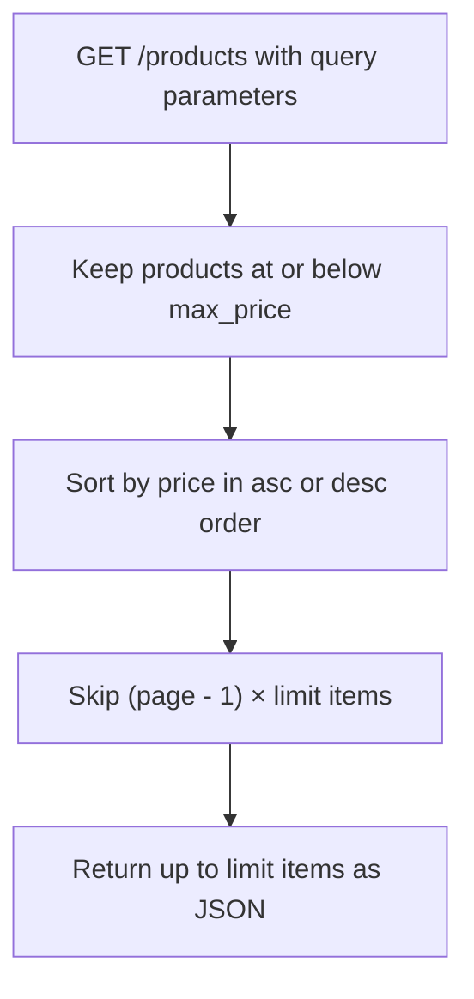

# FastAPI Basics — Products API

<p align="center">
  
  
</p>

A beginner-friendly FastAPI project for learning CRUD, request validation, filtering, sorting, and pagination. Products are stored in a Python dictionary in memory. Restarting or reloading the app resets the data to the values in `Main.py`.

## Run locally

From the repository root in Windows Command Prompt:

```cmd
cd APIBasics
python -m venv .venv
.venv\Scripts\activate.bat
python -m pip install fastapi uvicorn
python -m uvicorn Main:app --reload
```

`Main:app` loads the `app` variable from `Main.py`. Once Uvicorn starts, paste `http://127.0.0.1:8000/docs` into your browser to open Swagger UI. Choose an endpoint, select **Try it out**, fill in the inputs, and select **Execute**.

## Request flow



FastAPI uses the HTTP method and path to select a function. Pydantic validates the JSON bodies used by POST and PATCH. FastAPI serializes returned dictionaries and lists as JSON.

## How the product list is built



## Endpoints

| Method | Path | Action | Success status |
|---|---|---|---|
| GET | `/products/{product_id}` | Read one product by dictionary key | `200 OK` |
| GET | `/products` | Filter, sort, and paginate the product list | `200 OK` |
| POST | `/products` | Add a product with a generated ID | `201 Created` |
| PATCH | `/products/{product_id}` | Change a product's price | `200 OK` |
| DELETE | `/products/{product_id}` | Remove a product | `204 No Content` |

An unknown product key returns `404 Not Found`. Invalid input, such as a missing price in a POST body or `page=0` in a list request, returns `422`.

## Try it in Swagger UI

Expand a walkthrough below, then run the request in Swagger UI to see the status code and response body.

<details>
<summary><strong>Read the sample Pen</strong></summary>

Run `GET /products/{product_id}` with `product_id=82`.

```json
{"id": 1, "name": "Pen", "price": 5}
```

The sample uses `82` as the dictionary key and stores `1` in the Pen's `id` field. The URL uses the key, so request `/products/82` to find the Pen.

</details>

<details>
<summary><strong>Create, update, and delete a Notebook</strong></summary>

1. Send this body to `POST /products`:

   ```json
   {"name": "Notebook", "price": 50}
   ```

2. Copy the returned ID. On a fresh run, the first new product gets `83`.
3. Send `{"price": 60}` to `PATCH /products/{product_id}` using that ID, then use GET to verify the price.
4. After trying the list example below, run DELETE with the same ID. Expect `204 No Content`. Another GET for that ID returns `404`.

</details>

<details>
<summary><strong>Filter, sort, and paginate</strong></summary>

Paste `http://127.0.0.1:8000/products?max_price=100&order=desc&page=1&limit=1` into your browser. With the Pen and Notebook present, page 1 returns the Notebook and page 2 returns the Pen.

| Parameter | Meaning | Default |
|---|---|---|
| `max_price` | Include products priced at or below this value | Required |
| `order` | `asc` for lowest price first, `desc` for highest first | `asc` |
| `page` | Page number, starting at 1 | `1` |
| `limit` | Maximum items per page, at least 1 | `10` |

The function filters by price, sorts the matching products, then skips `(page - 1) * limit` items and returns up to `limit` items.

</details>

<details>
<summary><strong>Predict the response before you run it</strong></summary>

- Run `GET /products?max_price=4` on a fresh start. The result is `[]` because the Pen costs `5`.
- Run `GET /products?max_price=100&page=0`. Expect `422` because page numbers start at `1`.
- Run `GET /products/999` when that key is absent. Expect `404` and `{"detail": "Product not found"}`.

</details>
