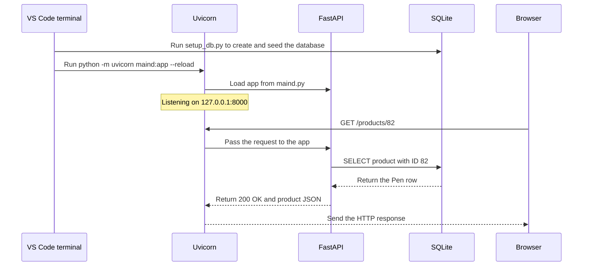

# FastAPI Products API

A local learning project that takes a product request from the browser to FastAPI and SQLite, then returns the result as JSON. The API supports CRUD, price filtering, sorting, pagination, and admin-only deletion.

**Try the API in your browser.** Once the server is running, open Swagger UI at `http://127.0.0.1:8000/docs`, pick an endpoint, and select **Try it out → Execute**.

## Quick start

Open the project folder in VS Code. Run these commands from the folder containing `maind.py`. The activation command below is for **Windows Command Prompt**.

```cmd
python -m venv .venv
.venv\Scripts\activate.bat
python -m pip install -r requirements.txt
python setup_db.py
python -m uvicorn maind:app --reload
```

`setup_db.py` creates `products.db` and seeds product **82**, a Pen priced at **5**. Wait for **Application startup complete**, then open product 82 at `http://127.0.0.1:8000/products/82` or Swagger UI at `http://127.0.0.1:8000/docs`.

| File | Purpose |
|---|---|
| `maind.py` | FastAPI routes, validation, login, and database operations |
| `setup_db.py` | Creates the SQLite table and seeds a sample product |
| `test_main.py` | Tests the delete endpoint's permission checks |
| `requirements.txt` | Python dependencies, including pytest and httpx for tests |
| `products.db` | Local database generated by the setup script |

## How it works



- **VS Code** is where you edit `maind.py` and start the server from the terminal.
- **Uvicorn** loads the `app` variable from `maind.py` and listens for HTTP requests.
- **FastAPI** matches the request method and path to a Python function. **Pydantic** validates JSON request bodies.
- **SQLite** stores the products in `products.db`. FastAPI sends the result back through Uvicorn as an HTTP response.
- **The browser** sends a GET when you open a product URL. Swagger UI at `/docs` lets you send requests with other methods and inspect their status codes and bodies.

## Endpoints

| Method | Path | What it does | Success |
|---|---|---|---|
| GET | `/products/{product_id}` | Read one product | `200 OK` |
| GET | `/products?max_price=100` | List products with filtering, sorting, and pagination | `200 OK` |
| POST | `/products` | Create a product | `201 Created` |
| PATCH | `/products/{product_id}` | Update a product's price | `200 OK` |
| POST | `/login` | Exchange demo credentials for a bearer token | `200 OK` |
| DELETE | `/products/{product_id}` | Delete a product using an admin token | `204 No Content` |

A missing product returns `404`. An invalid request body or query parameter can return `422`. A missing or invalid delete token returns `401`, and a valid customer token returns `403`.

## Try it

<details>
<summary><strong>1. Create, read, and update a product</strong></summary>

1. In Swagger UI at `http://127.0.0.1:8000/docs`, expand **POST /products**, select **Try it out**, and send:

   ```json
   {"name": "Notebook", "price": 50}
   ```

2. Check for `201 Created` and copy the returned ID. On a freshly seeded database it will be `83`.
3. Open `GET /products/{product_id}` in Swagger UI and enter that ID. The response includes the Notebook and its price.
4. Send `{"price": 60}` to `PATCH /products/{product_id}` with the same ID. Read the product again to verify the new price.

</details>

<details>
<summary><strong>2. Filter, sort, and paginate</strong></summary>

Open the product list at `http://127.0.0.1:8000/products?max_price=100&order=desc&page=1&limit=1`.

| Parameter | Meaning | Default |
|---|---|---|
| `max_price` | Include products at or below this price | Required |
| `order` | `asc` for lowest price first, `desc` for highest first | `asc` |
| `page` | Page number, starting at 1 | `1` |
| `limit` | Maximum products per page, at least 1 | `10` |

SQLite filters the rows, sorts them by price, then skips `(page - 1) * limit` rows and returns up to `limit` rows. With only the Pen and Notebook present, the example returns the Notebook first. Change `page=1` to `page=2` to see the Pen.

</details>

<details>
<summary><strong>3. Verify data survives a restart</strong></summary>

Stop Uvicorn with **Ctrl+C**, then run:

```cmd
python -m uvicorn maind:app --reload
```

Use GET with the Notebook's ID again. The product and updated price are still there because the app reads from `products.db`.

To see all saved rows directly, run this from the project folder:

```cmd
python -c "import sqlite3; db = sqlite3.connect('file:products.db?mode=ro', uri=True); print(db.execute('SELECT id, name, price FROM products ORDER BY id').fetchall()); db.close()"
```

</details>

<details>
<summary><strong>4. Test admin-only deletion</strong></summary>

Use a disposable product and replace `83` in the command with its actual ID. Login uses local demo accounts.

| Role | Username | Password |
|---|---|---|
| Customer | `customer` | `customer-demo` |
| Admin | `admin` | `admin-demo` |

Send the username and password as JSON to `POST /login` in Swagger UI. For example:

```json
{"username": "customer", "password": "customer-demo"}
```

Copy the `access_token` into the command without its JSON quotes. Keep the whole header inside one pair of double quotes.

```cmd
curl.exe -i -X DELETE "http://127.0.0.1:8000/products/83" -H "Authorization: Bearer YOUR_TOKEN"
```

Try the requests in this order:

1. Omit the header to get `401 Unauthorized`.
2. Use a customer token to get `403 Forbidden`.
3. Log in as admin and use the admin token to get `204 No Content`.
4. Read the deleted product with GET to verify it now returns `404 Not Found`.

The app maps a bearer token to a user, checks the user's role, then runs the SQL delete if authorized. Tokens live in memory, so sign in again after a restart or reload. The login implementation and credentials are for local practice.

</details>

## Tests

```cmd
python -m pytest -q test_main.py
```

`TestClient` sends requests directly to the FastAPI app, so the tests can run with Uvicorn stopped. The admin test uses a temporary SQLite database.

| Test | Checks |
|---|---|
| No token | DELETE returns `401` |
| Customer token | DELETE returns `403` |
| Admin token | DELETE returns `204`, then GET returns `404` |

Expected result: **3 passed**.

## Troubleshooting

| Symptom | Check |
|---|---|
| `No module named uvicorn` | Activate `.venv` and install `requirements.txt`. |
| `Could not import module "maind"` | Run from the project folder and check the filename is `maind.py`. |
| `{"detail":"Not Found"}` at the base URL | Open `/docs` or `/products/82`. |
| `no such table: products` | Run `python setup_db.py` from the project folder. |
| `401` after restarting | Sign in again and use the new token. |
